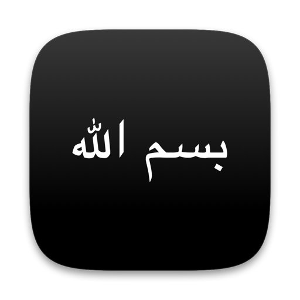
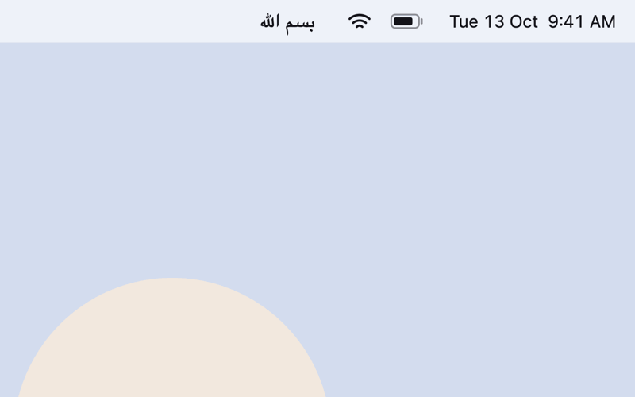

<p align="center">
  
</p>

<h1 align="center">Bismillah</h1>

<p align="center">
  Shows the bismillah on your screen every time your Mac wakes, with dhikr reminders and a tasbih counter in the menu bar.
</p>

<p align="center">
  <a href="../../releases/latest"><b>Download</b></a> ·
  <a href="#install"><b>Install</b></a> ·
  <a href="#updates"><b>Updates</b></a> ·
  <a href="#build-from-source"><b>Build from source</b></a> ·
  <a href="LICENSE"><b>MIT License</b></a>
</p>

<br>

Bismillah is a small menu bar app for Mac. It shows a black popup in the middle of the screen with
بسم الله الرحمن الرحيم, either fading in and out (the default) or written out stroke by stroke, the way Apple's
"hello" animation is drawn. You choose under **Animation Mode**.

- Shows when you open the app and every time your Mac wakes, so it greets you when you open the lid. If the
  lid opens onto the lock screen it waits until you unlock.
- Optional **dhikr reminders**: *سُبْحَانَ ٱللَّهِ وَبِحَمْدِهِ*, *أَسْتَغْفِرُ ٱللَّهَ ٱلْعَظِيمَ* or *ٱللَّهُمَّ صَلِّ عَلَىٰ مُحَمَّدٍ* slides
  out of the notch at random times through the day, as many times a day as you choose.
- A **tasbih counter** in the menu bar: press Space to count *سُبْحَانَ ٱللَّهِ وَبِحَمْدِهِ* up to 100. It remembers your number, and links to the hadith about saying it 100 times.
- An optional **transliteration** under every popup, for anyone still learning to read Arabic.
- **Global shortcuts** and `bismillah://` links, to show the bismillah or open the counter from anywhere.
- A menu bar item that reads **بسم الله**, with Show Bismillah, Animation Mode, Dhikr Reminders, Tasbih Counter, Launch at Login,
  Show on All Screens, the update options and Quit. No Dock icon.
- No account, and it only remembers its own settings. Its only network access is the update check (see [Updates](#updates)).

In writing mode the letters are real font outlines revealed by a pen path that follows each letter's centreline:
right to left, one word at a time, with the dots and vowel marks added last. With Reduce Motion turned on, it shows
the finished text without any animation.

Requires macOS 14 or later (Apple Silicon and Intel).

<p align="center">
  
  
</p>

<p align="center">
  <sub><b>When your Mac wakes:</b> the bismillah fades in and out (or is written out). &nbsp;·&nbsp; <b>Through the day:</b> a dhikr opens out of the notch.</sub>
</p>

## Install

The first two options use **Terminal**, the app that comes with every Mac. Open it by pressing Cmd+Space (**⌘** + **Space**), typing
`Terminal` and pressing Return. Then paste a command below and press Return. If you'd rather not use Terminal, the
last option works without it.

**With curl** (comes with every Mac, no Homebrew needed). Paste this into Terminal:

```bash
curl -fsSL https://raw.githubusercontent.com/hafizuddin-a/bismillah-menubar/main/get.sh | bash
```

This downloads the latest release from GitHub, checks it against its published checksum, puts `Bismillah.app` in
your Applications folder and opens it. Files downloaded with curl aren't quarantined, so there is no macOS warning
to click through. The script is [`get.sh`](get.sh), about 50 lines, if you'd like to read it first. Run it again
any time to reinstall the latest version.

**With Homebrew:**

```bash
brew install --cask hafizuddin-a/tap/bismillah
```

Homebrew clears macOS's quarantine flag for this app (the cask is [in the tap](https://github.com/hafizuddin-a/homebrew-tap)
if you want to read it), so it opens without the warning described below.

**Or by hand** (no Terminal):

1. Download `Bismillah-<version>.zip` from the [Releases](../../releases) page and unzip it.
2. Drag `Bismillah.app` to your Applications folder.
3. Open it. macOS will say it can't verify the developer, because this app is not notarized by Apple:
   - **macOS 15 and later:** click Done, open **System Settings > Privacy & Security**, scroll down and click
     **Open Anyway** next to Bismillah, then open the app again.
   - **Earlier macOS:** right-click the app, choose **Open**, then **Open** again.
   - Or, in Terminal: `xattr -dr com.apple.quarantine /Applications/Bismillah.app`
4. The bismillah appears straight away and **بسم الله** appears in the menu bar. Choose **Launch at
   Login** from its menu to have it start with your Mac.

Prefer to read the code first? It is all in this repository, and you can build it yourself (below).

## Use

Click **بسم الله** in the menu bar:

| Item            | What it does |
|-----------------|--------------|
| Show Bismillah  | Shows it again |
| Dhikr Reminders | Choose how many random dhikr popups a day (off by default) and the hours they appear in, skip them while you share your screen, see when the next one is, or show one now |
| Tasbih Counter  | Opens a small counter under the menu bar: press Space to count up to 100 |
| Animation Mode  | **Fading** (the default) fades the bismillah in and out; **Writing** writes it out like handwriting |
| Show Transliteration | Adds the reading in Latin letters under every popup and the counter (off by default) |
| Show on All Screens | Shows the bismillah and the dhikr popups on every screen at once instead of just one (off by default) |
| Global Shortcuts | Turns the system-wide shortcuts on or off (on by default), see [Shortcuts and links](#shortcuts-and-links) |
| Launch at Login | Starts Bismillah when you log in (tick to turn on) |
| Update Automatically | Checks for new versions and installs them by itself (on by default) |
| Check for Updates… | Checks right now and tells you what it found |
| Quit Bismillah  | Quits the app |

The popup stays for about seven seconds, then fades away by itself. Click it or press Esc to dismiss it sooner.

## Animation modes

Choose **Animation Mode** in the menu, and the bismillah plays straight away in the mode you picked. Both modes keep the popup on screen for the same length of time.

<p align="center">
  
  
</p>

<p align="center">
  <sub><b>Writing:</b> the pen writes it out, right to left. &nbsp;·&nbsp; <b>Fading:</b> it fades in, pauses, and fades out. This is the default.</sub>
</p>

The fade in and out are quick, about half a second each, with the rest of the time spent holding the finished text.
With Reduce Motion turned on, both modes just show the text.

## Tasbih counter

Choose **Tasbih Counter** in the menu and a small glass popup drops down from the menu bar item, the way a menu
does, with *سُبْحَانَ ٱللَّهِ وَبِحَمْدِهِ* and a ring that fills toward 100.

<p align="center">
  
</p>

- Press **Space** to count one. Holding the key down counts only once.
- It stays open until you close it, so you can leave it up while you work. Press **Esc**, click the ✕, or choose
  **Tasbih Counter** again to close it.
- The number is remembered, between openings and when you quit and reopen the app.
- Rest the pointer on the number and it turns into a reset icon. Click it to clear the current round.
- **Hadith** opens the hadith about saying *Subhan Allah wa bihamdihi* a hundred times a day (Sahih al-Bukhari 6405,
  on sunnah.com) in your browser. Bismillah itself still makes no network request.
- Tick **Show saved count in menu bar** to see your number next to **بسم الله**.
- At 100 the ring turns green and the round is complete. Keep counting and the next round starts from 1, with the rounds you've finished shown beside the hint; nothing is lost. To start over, hover the ring and click the reset icon: it clears only the round you're on (the hint says so straight away), and rounds you've already finished stay.

## Dhikr reminders

Open **Dhikr Reminders** in the menu and pick how many a day: 1, 3, 5, 10, 15, 20 or 30. It is off until you choose.
At random moments, a black shape opens out of the notch (on a Mac without a notch it opens from the top centre of the
screen), shows one dhikr for a few seconds, then folds back in. There is no writing animation here, just the text.
Click it to dismiss it early.

- *سُبْحَانَ ٱللَّهِ وَبِحَمْدِهِ* (Subhanallahi wa bihamdihi)
- *أَسْتَغْفِرُ ٱللَّهَ ٱلْعَظِيمَ* (Astaghfirullah al-Azim)
- *ٱللَّهُمَّ صَلِّ عَلَىٰ مُحَمَّدٍ* (Allahumma salli ala Muhammad)

Each popup picks one at random, never the same one twice in a row.

- **Starts at** and **Ends at** in the submenu set the hours the popups can appear in. The default is 08:00 to 22:00.
  The last option for the end, marked "end of day", runs through to midnight.
- The times are random but spread over those hours, at least a few minutes apart. **Next: …** in the submenu shows
  when the next one is due, and **Show Now** shows one straight away.
- **Skip While Screen Sharing** (on by default): a reminder that comes due while you share your screen is held back
  and planned again for after you stop. Being in a meeting is fine, only sharing is skipped. macOS has no official way
  to tell whether you are sharing, so Bismillah looks for the "sharing" bar that Zoom, Meet, Teams and similar apps show.
  To read those, it asks, once and with an explanation, for the **Screen Recording** permission in macOS. Bismillah
  doesn't record or look at your screen: macOS just uses that name for the permission that lets an app read window
  titles, and nothing leaves your Mac. It is optional, but without it Bismillah can't reliably tell when you are sharing.
  Turning it on in System Settings asks for an administrator's password, and since Bismillah isn't signed with an Apple
  Developer ID, macOS may ask you to allow it again after an update. When it notices a share, **Next:** in the submenu
  changes to "Paused while screen sharing".
- Today's plan is saved, so quitting and reopening the app doesn't reshuffle it or repeat popups. If you change the
  number or the hours mid-day, only the popups still to come are re-planned.
- **Your number for the day stays your number.** A popup that comes due while you are away (the Mac is asleep or
  Bismillah is closed, the screen is locked or off, you are sharing your screen, or the handwriting popup is on
  screen) is never shown late and never queued up. Once you are back, the popups still owed are planned again at
  random over the rest of your hours, starting a few minutes after you return, so you don't get a burst. Late in the
  day they are packed a little closer (never under 5 minutes apart) so the total still fits. If you were away most of
  the day, only what fits in the hours left is shown, and nothing carries over to tomorrow. **Next: soon** in the
  submenu means it is being planned again.
- It never takes focus, and only the black shape reacts to clicks. With Reduce Motion on, it fades in and out
  instead of opening.

## Shortcuts and links

Two shortcuts work from any app, on by default (turn them off under **Global Shortcuts**):

| Shortcut | Does |
|----------|------|
| **Control-Option-B** | Shows the bismillah |
| **Control-Option-T** | Opens or closes the tasbih counter |

Bismillah also answers `bismillah://` links, so Shortcuts, scripts or other apps can trigger it, for example
`open "bismillah://show"` in Terminal:

| Link | Does |
|------|------|
| `bismillah://show` | Shows the bismillah |
| `bismillah://dhikr` | Shows a dhikr popup |
| `bismillah://counter` | Opens the tasbih counter |
| `bismillah://count` | Adds one to the counter |
| `bismillah://count?n=33` | Adds 33 (any number from 1 to 100; going past 100 starts the next round) |

**In the Shortcuts app:** add an **Open URLs** action, type one of the links above, and name the shortcut, e.g.
"Count 33 after prayer". From there you can run it from Spotlight, the menu bar, Siri ("Hey Siri, Count 33 after
prayer") or a keyboard shortcut, or add it to an automation. (Bismillah doesn't offer its own Shortcuts actions
because those need an Xcode-built app; links do the same job.)

## Updates

Bismillah looks for a newer version on this repository's [Releases](../../releases) page about once a week:
shortly after it starts, or after your Mac wakes, once a week has passed since the last check. When there is one
it downloads it, checks it, swaps the app in place and reopens quietly (no popup). It waits for the popup to
finish first.

- **Check for Updates…** in the menu checks straight away.
- Untick **Update Automatically** to stop the background checks. With it off, Bismillah makes no network
  requests at all and only checks when you ask.
- Every release is signed with a private key that stays on the maintainer's Mac, and the matching public
  key is built into the app. An update with the wrong signature is refused, even if the file on GitHub were
  replaced.
- Updating in place needs Bismillah to sit somewhere it can write to, such as Applications. From a read-only
  place, such as straight out of a fresh download, it offers the release page instead.
- Updating never needs Homebrew or Terminal: however you installed it, the app updates itself from this repository's
  releases. With Homebrew, `brew upgrade` leaves it alone because it updates itself.

## What it can't do

- It can't tell for sure when you are sharing your screen, because macOS doesn't say. **Skip While Screen Sharing**
  reads the sharing bars of common apps (it works best with the Screen Recording permission) and may miss others.
- It can't appear above the lock screen. If your Mac is locked when one comes due, the popups still owed are planned
  again for after you unlock.
- Dhikr popups come from the notch only on a Mac that has one, and by default only on its own screen. Elsewhere they
  open from the top centre of the screen you are using. With **Show on All Screens** ticked they appear on every screen,
  opening from the notch on screens that have one and from the top centre on the rest.
- Launch at Login is most reliable once the app is in your Applications folder.
- It is not notarized, so macOS asks you to approve it the first time (see Install).

## Build from source

You need Xcode's command-line tools (`xcode-select --install`).

```bash
./build.sh      # builds Bismillah.app (universal)
./install.sh    # builds, installs to ~/Applications and opens it
./release.sh    # builds dist/Bismillah-<version>.zip and its update signature for GitHub Releases
```

Releases are signed with a private Ed25519 key kept outside the repository (`~/.config/bismillah/update-signing.key`);
the public key is in [tools/update-public-key.txt](tools/update-public-key.txt) and is built into the app. To
publish your own fork, make a key with `tools/update_key.swift keygen <file>`, replace the public key, and change
`repository` in [Updater.swift](Sources/Updater.swift). `./publish.sh <notes.md>` then builds, signs, creates the
GitHub release and updates the Homebrew cask in one go.

The whole app is a few small files in [Sources](Sources). The handwriting data
([BismillahData.swift](Sources/BismillahData.swift)) is generated, not hand-written: `tools/gen_strokes.swift`
shapes the text with CoreText (so letter joins and vowel marks are right), thins each letter to a centreline,
orders the pen strokes like a scribe and writes the timings. It uses Geeza Pro, which ships with macOS; pass the
name of any other installed Arabic font to change the look.

```bash
swiftc -O tools/gen_strokes.swift -o /tmp/gen_strokes
mkdir -p /tmp/out && /tmp/gen_strokes "Geeza Pro" /tmp/out
cp /tmp/out/BismillahData.swift Sources/
```

`tools/make_icon.sh` redraws the app icon, and `tools/make_demo_gif.sh` redraws the two animations at the top of this page.

## Uninstall

With Homebrew: `brew uninstall --cask bismillah`.

By hand: choose **Launch at Login** again to untick it if you ticked it, choose **Quit Bismillah**, then drag
`Bismillah.app` to the Trash. Bismillah saves nothing else but its settings (the update and reminder choices).
