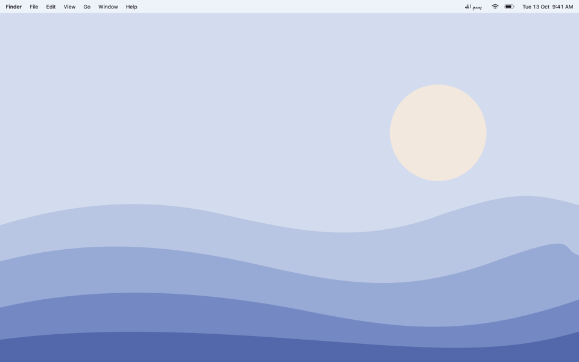

<p align="center">
  
</p>

<h1 align="center">Bismillah</h1>

<p align="center">
  Writes out the bismillah on your screen, like handwriting, every time your Mac wakes.
</p>

<p align="center">
  <a href="../../releases/latest"><b>Download</b></a> ·
  <a href="#install"><b>Install</b></a> ·
  <a href="#updates"><b>Updates</b></a> ·
  <a href="#build-from-source"><b>Build from source</b></a> ·
  <a href="LICENSE"><b>MIT License</b></a>
</p>

<br>

Bismillah is a small menu bar app for Mac. It shows a black popup in the middle of the screen and writes out
بسم الله الرحمن الرحيم stroke by stroke, the way Apple's "hello" animation is drawn.

- Shows when you open the app and every time your Mac wakes, so it greets you when you open the lid. If the
  lid opens onto the lock screen it waits until you unlock.
- Optional **dhikr reminders**: *سُبْحَانَ ٱللَّهِ وَبِحَمْدِهِ*, *أَسْتَغْفِرُ ٱللَّهَ ٱلْعَظِيمَ* or *ٱللَّهُمَّ صَلِّ عَلَىٰ مُحَمَّدٍ* slides
  out of the notch at random times through the day, as many times a day as you choose.
- A menu bar item that reads **بسم الله**, with Show Bismillah, Dhikr Reminders, Launch at Login, the update options and Quit.
  No Dock icon.
- No account, and it only remembers its own settings. Its only network access is the update check (see [Updates](#updates)).

The letters are real font outlines revealed by a pen path that follows each letter's centreline: right to
left, one word at a time, with the dots and vowel marks added last. With Reduce Motion turned on, it shows the
finished text without the writing.

Requires macOS 14 or later (Apple Silicon and Intel).

<p align="center">
  
</p>

## Install

**With Homebrew:**

```bash
brew install --cask hafizuddin-a/tap/bismillah
```

Homebrew clears macOS's quarantine flag for this app (the cask is [in the tap](https://github.com/hafizuddin-a/homebrew-tap)
if you want to read it), so it opens without the warning described below.

**Or by hand:**

1. Download `Bismillah-<version>.zip` from the [Releases](../../releases) page and unzip it.
2. Drag `Bismillah.app` to your Applications folder.
3. Open it. macOS will say it can't verify the developer, because this app is not notarized by Apple:
   - **macOS 15 and later:** click Done, open **System Settings > Privacy & Security**, scroll down and click
     **Open Anyway** next to Bismillah, then open the app again.
   - **Earlier macOS:** right-click the app, choose **Open**, then **Open** again.
   - Or, in Terminal: `xattr -dr com.apple.quarantine /Applications/Bismillah.app`
4. The bismillah is written out straight away and **بسم الله** appears in the menu bar. Choose **Launch at
   Login** from its menu to have it start with your Mac.

Prefer to read the code first? It is all in this repository, and you can build it yourself (below).

## Use

Click **بسم الله** in the menu bar:

| Item            | What it does |
|-----------------|--------------|
| Show Bismillah  | Writes it out again |
| Dhikr Reminders | Choose how many random dhikr popups a day (off by default) and the hours they appear in, see when the next one is, or show one now |
| Launch at Login | Starts Bismillah when you log in (tick to turn on) |
| Update Automatically | Checks for new versions and installs them by itself (on by default) |
| Check for Updates… | Checks right now and tells you what it found |
| Quit Bismillah  | Quits the app |

The popup fades away by itself a couple of seconds after it finishes writing. Click it or press Esc to dismiss
it sooner.

## Dhikr reminders

Open **Dhikr Reminders** in the menu and pick how many a day: 1, 3, 5, 10, 15, 20 or 30. It is off until you choose.
At random moments, a black shape opens out of the notch (on a Mac without a notch it opens from the top centre of the
screen), shows one dhikr for a few seconds, then folds back in. There is no writing animation here, just the text.
Click it to dismiss it early.

- *سُبْحَانَ ٱللَّهِ وَبِحَمْدِهِ* (Subhanallahi wa bihamdihi)
- *أَسْتَغْفِرُ ٱللَّهَ ٱلْعَظِيمَ* (Astaghfirullah al-Azim)
- *ٱللَّهُمَّ صَلِّ عَلَىٰ مُحَمَّدٍ* (Allahumma salli ala Muhammad)

Each popup picks one at random, never the same one twice in a row.

- **Starts at** and **Ends at** in the submenu set the hours the popups can appear in. The default is 08:00 to 22:00.
  The last option for the end, marked "end of day", runs through to midnight.
- The times are random but spread over those hours, at least a few minutes apart. **Next: …** in the submenu shows
  when the next one is due, and **Show Now** shows one straight away.
- Today's plan is saved, so quitting and reopening the app doesn't reshuffle it or repeat popups. If you change the
  number or the hours mid-day, only the popups still to come are re-planned.
- A popup that comes due while your Mac is asleep is skipped, not shown late. If the screen is locked or the
  handwriting popup is showing, it waits a couple of minutes and tries again.
- It never takes focus, and only the black shape reacts to clicks. With Reduce Motion on, it fades in and out
  instead of opening.

## Updates

Bismillah looks for a newer version on this repository's [Releases](../../releases) page about once a week:
shortly after it starts, or after your Mac wakes, once a week has passed since the last check. When there is one
it downloads it, checks it, swaps the app in place and reopens quietly (no popup). It waits for the popup to
finish first.

- **Check for Updates…** in the menu checks straight away.
- Untick **Update Automatically** to stop the background checks. With it off, Bismillah makes no network
  requests at all and only checks when you ask.
- Every release is signed with a private key that stays on the maintainer's Mac, and the matching public
  key is built into the app. An update with the wrong signature is refused, even if the file on GitHub were
  replaced.
- Updating in place needs Bismillah to sit somewhere it can write to, such as Applications. From a read-only
  place, such as straight out of a fresh download, it offers the release page instead.
- With Homebrew, `brew upgrade` leaves it alone because it updates itself.

## What it can't do

- It can't appear above the lock screen. If your Mac locks while it sleeps, the popup waits and shows right
  after you unlock.
- Dhikr popups come from the notch only on a Mac that has one, and only on its own screen. Elsewhere they open from
  the top centre of the screen you are using.
- Launch at Login is most reliable once the app is in your Applications folder.
- It is not notarized, so macOS asks you to approve it the first time (see Install).

## Build from source

You need Xcode's command-line tools (`xcode-select --install`).

```bash
./build.sh      # builds Bismillah.app (universal)
./install.sh    # builds, installs to ~/Applications and opens it
./release.sh    # builds dist/Bismillah-<version>.zip and its update signature for GitHub Releases
```

Releases are signed with a private Ed25519 key kept outside the repository (`~/.config/bismillah/update-signing.key`);
the public key is in [tools/update-public-key.txt](tools/update-public-key.txt) and is built into the app. To
publish your own fork, make a key with `tools/update_key.swift keygen <file>`, replace the public key, and change
`repository` in [Updater.swift](Sources/Updater.swift). `./publish.sh <notes.md>` then builds, signs, creates the
GitHub release and updates the Homebrew cask in one go.

The whole app is a few small files in [Sources](Sources). The handwriting data
([BismillahData.swift](Sources/BismillahData.swift)) is generated, not hand-written: `tools/gen_strokes.swift`
shapes the text with CoreText (so letter joins and vowel marks are right), thins each letter to a centreline,
orders the pen strokes like a scribe and writes the timings. It uses Geeza Pro, which ships with macOS; pass the
name of any other installed Arabic font to change the look.

```bash
swiftc -O tools/gen_strokes.swift -o /tmp/gen_strokes
mkdir -p /tmp/out && /tmp/gen_strokes "Geeza Pro" /tmp/out
cp /tmp/out/BismillahData.swift Sources/
```

`tools/make_icon.sh` redraws the app icon, and `tools/make_demo_gif.sh` redraws the animation at the top of this page.

## Uninstall

With Homebrew: `brew uninstall --cask bismillah`.

By hand: choose **Launch at Login** again to untick it if you ticked it, choose **Quit Bismillah**, then drag
`Bismillah.app` to the Trash. Bismillah saves nothing else but its settings (the update and reminder choices).
